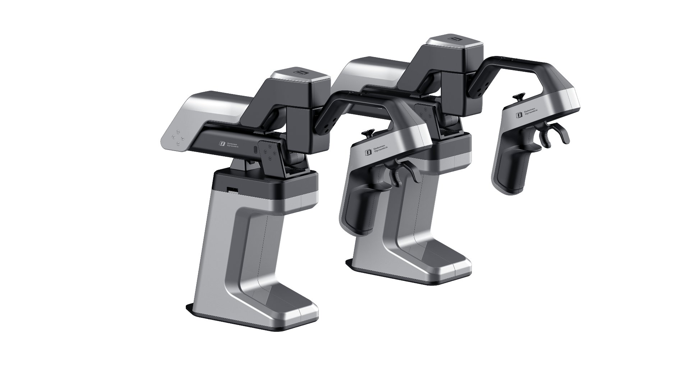

# A1Z-T: A1Z Teleoperation

[简体中文](README.md)

<p align="center">
  
</p>

Single-arm and dual-arm teleoperation for A1Z-T and A1Z. Dual-arm mode runs the two arms in independent threads.

## Install

Requires Ubuntu 22.04 and CPython 3.11.

`galaxea_a1z` is a separate SDK repository. Clone it at the repository root (the path is listed in `.gitignore`):

```bash
git clone --branch main https://github.com/userguide-galaxea/galaxea_a1z.git galaxea_a1z
```

It follows upstream `main`; the commit tested with this repository is `156af498a947a830ca38efff4dd08fd2da96a200`. Update with `git -C galaxea_a1z pull --ff-only`, and roll back with `git -C galaxea_a1z checkout 156af498a947a830ca38efff4dd08fd2da96a200` if a newer revision misbehaves.

Without a local clone you can still run `python -m pip install -e '.[sdk]'` to install the tested `a1z` revision from GitHub, at the cost of not following `main`.

Choose one environment setup method.

### venv

First check that Python 3.11 is installed and available on `PATH`:

```bash
python3.11 --version
```

This project includes CPython 3.11 bytecode, so the system Python 3.10 cannot replace it. If you see `command not found: python3.11`, follow the [uv installation instructions](https://docs.astral.sh/uv/getting-started/installation/), then let uv download Python 3.11 and create an environment with pip:

```bash
uv venv --python 3.11 --seed --system-site-packages .venv && \
source .venv/bin/activate
```

If Python 3.11 is already installed, you can also create the environment with the standard library:

```bash
python3.11 -m venv --system-site-packages .venv && \
source .venv/bin/activate
```

If `venv` or `ensurepip` is missing, install the venv component matching Python 3.11. An apt-based Python 3.11 installation typically also needs `python3.11-venv` from the same package source. If that package is unavailable, use the uv method above.

Activate only after creation succeeds; a failed creation may leave `.venv/bin/activate` missing. After activation, run `python --version` and confirm `Python 3.11.x`. If `.venv` already uses another Python version, move the old environment aside before creating a new one.

### Conda

Install Conda first.

```bash
conda create -n a1z-teleop python=3.11 -y
conda activate a1z-teleop
```

With the chosen environment active, install the SDK and the project from the repository root:

```bash
python -m pip install -e ./galaxea_a1z
python -m pip install -e .
```

If pip downloads are slow, use the [Tsinghua PyPI mirror](https://mirrors.tuna.tsinghua.edu.cn/help/pypi/):

```bash
python -m pip install -e . -i https://pypi.tuna.tsinghua.edu.cn/simple
```

When using venv, you can also save the mirror setting for the current virtual environment so later installs do not need `-i`:

```bash
python -m pip config --site set global.index-url https://pypi.tuna.tsinghua.edu.cn/simple
```

The mirror only speeds up PyPI package downloads; `galaxea_a1z` is installed editable from the local clone and does not use the package index.

## Set up devices

Run the following commands from the repository root. Single-arm users can use the actual device names without binding ports. Stable names are recommended for dual-arm use to prevent left and right device numbers from swapping after reconnection or reboot.

### Single arm without port binding

Connect one Leader and Follower pair and check the actual serial and CAN interfaces:

```bash
ls /dev/ttyACM*
ip -br link
```

For devices named `/dev/ttyACM0` and `can0`, configure CAN and then start teleoperation:

```bash
bash scripts/setup_can.sh can0
python teleop_single.py --port /dev/ttyACM0 --can can0
```

Replace these names if your devices differ. Check the numbering and configure CAN again after reconnection or reboot. If no CAN interface appears yet, `setup_can.sh can0` attempts to load the adapter driver and waits for the interface. If it still fails, check the adapter connection using the script's error message.

### Bind stable names for one or two arms

Binding identifies adapters by their USB serial numbers, independently of USB ports or temporary device numbers. A single arm uses `/dev/leader_left` and `can_left`; dual-arm use adds `/dev/leader_right` and `can_right`.

1. **Identify each side's adapter serial numbers.** For one arm, connect only that pair. For two arms, connect only the left pair, record its serial numbers, disconnect it, then repeat with only the right pair. Run each time:

```bash
bash scripts/setup_ports.sh --list
```

`Leader candidate` identifies a Leader serial adapter; `CAN candidate` identifies a Follower CAN adapter. Use the value after `serial=`, rather than `/dev/ttyACM0` or `can0`. If only the Leader appears, initialize the current CAN adapter with `bash scripts/setup_can.sh can0`, then list again. If the interface already exists under another name, replace `can0` with that name. CAN adapters in this list must use the `gs_usb` driver.

2. **Install binding rules.** Replace the placeholders below with the recorded serial numbers. The script uses `sudo` to install system rules and may prompt for your password.

For one arm, provide only the two left-side values:

```bash
LEADER_LEFT_SERIAL=LEFT_LEADER_SERIAL \
CAN_LEFT_SERIAL=LEFT_CAN_SERIAL \
bash scripts/setup_ports.sh
```

For two arms, provide all four values together. Left and right adapters of the same type must have different serial numbers:

```bash
LEADER_LEFT_SERIAL=LEFT_LEADER_SERIAL \
CAN_LEFT_SERIAL=LEFT_CAN_SERIAL \
LEADER_RIGHT_SERIAL=RIGHT_LEADER_SERIAL \
CAN_RIGHT_SERIAL=RIGHT_CAN_SERIAL \
bash scripts/setup_ports.sh
```

3. **Reconnect the adapters or reboot, then verify the stable names.** For one arm:

```bash
ls -l /dev/leader_left
ip -br link show can_left
```

For two arms, also check:

```bash
ls -l /dev/leader_right
ip -br link show can_right
```

Once the serial links exist and CAN interface names are correct, run only the first command for one arm, or both commands for two arms:

```bash
bash scripts/setup_can.sh can_left
bash scripts/setup_can.sh can_right
```

Binding rules normally need installing only once. Run the appropriate `setup_can.sh` command after each reboot or CAN adapter reconnection. Single-arm users must pass the interface name explicitly; without an argument, the script waits for two CAN interfaces.

Select `EVT` or `PVT` with `a1z_t_version` in [`config.yaml`](config.yaml) before running. Single-arm users without binding should use the actual device names shown above; subsequent examples use bound names.

## Try Teleoperation

```bash
python teleop_single.py --port /dev/leader_left --can can_left

python teleop_dual.py --port /dev/leader_left --port_right /dev/leader_right \
  --can_left can_left --can_right can_right
```

After startup homing, use the control button to start or stop tracking. Press `Ctrl+C` to exit. Use `--help` on either entrypoint for its available options. Dual-arm mode does not bind CPU cores by default; use `--cpu-bind` only after selecting suitable cores for the host computer. Verify device assignment, motion direction, and clear operating space before enabling teleoperation.

## Device checks

If ports are not bound, replace `/dev/leader_left` below with the actual serial device, such as `/dev/ttyACM0`.

**`scan_servos.py`: Scan serial devices.** It probes the selected port at 1 Mbps by default and lists responding device IDs, model numbers, and baud rate. Use it to check the port and device connections. Add `--full` to probe each ID if the default scan misses a device. The tool sends queries only; it does not command homing or movement.

```bash
python tools/scan_servos.py --port /dev/leader_left
python tools/scan_servos.py --port /dev/leader_left --full
```

**`a1z_t_test.py`: Check the A1Z-T device.** It displays joint and trigger positions, temperature, current, voltage, and peak current in real time. Controller button status is also shown by default. Both single-arm and dual-arm checks are supported. On startup, the tool moves the A1Z-T to zero and holds it; press the control button or Enter to release it and start monitoring. Further presses can return it to zero or release it. This tool does not control the A1Z. Clear the A1Z-T operating space before running it.

```bash
python tools/a1z_t_test.py --port /dev/leader_left
python tools/a1z_t_test.py --dual --port /dev/leader_left --port-right /dev/leader_right
```

## License

Original project materials are licensed under the [Galaxea Dynamics A1Z-T LICENSE AGREEMENT](LICENSES.md); see [NOTICE](NOTICE). Bundled components retain their licenses in [a1z_t/licenses](a1z_t/licenses). Keep each adjacent `.pyc.license` notice when redistributing bytecode.
